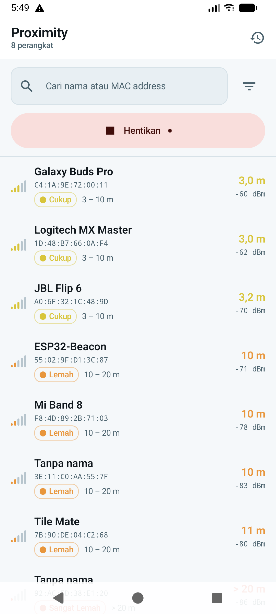
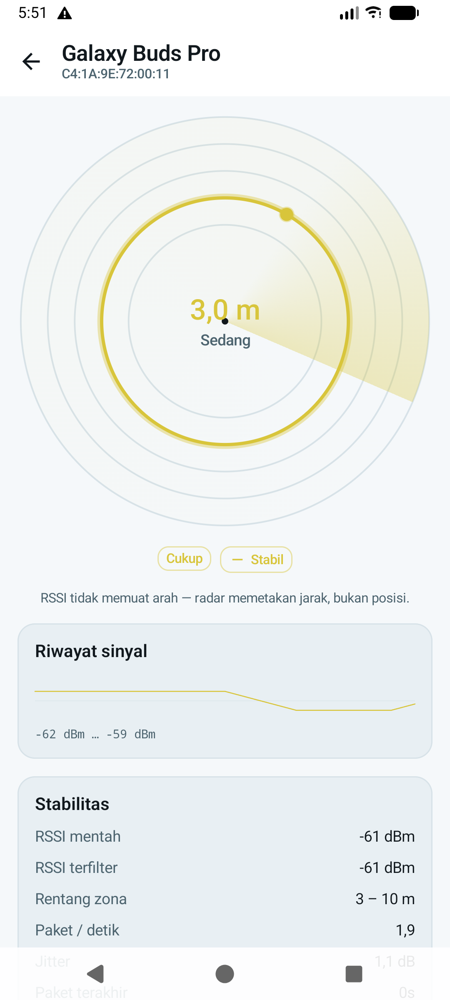
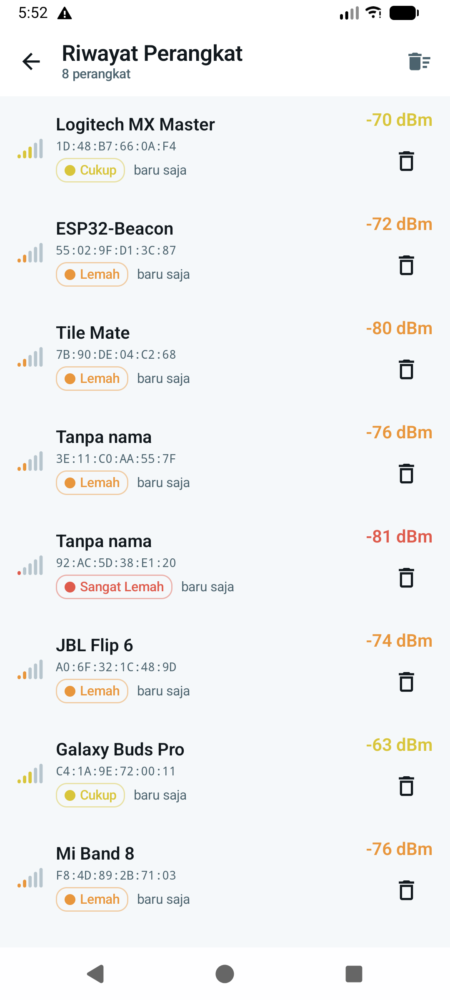
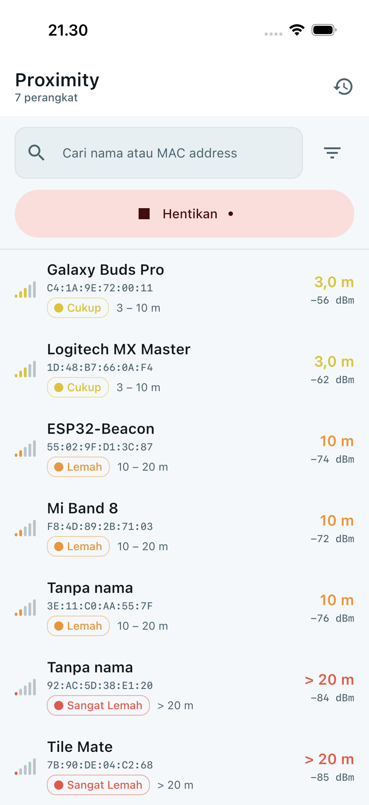
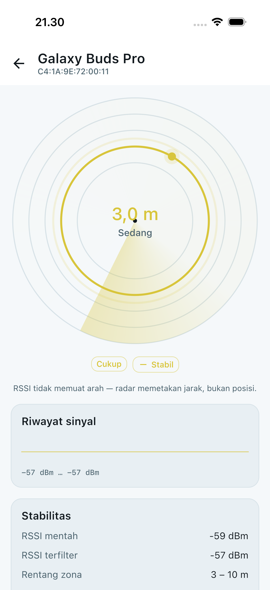
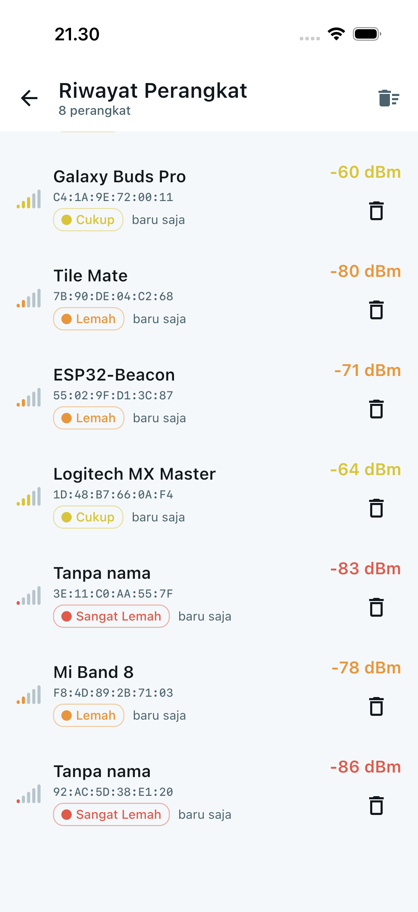

# Proximity — BLE Proximity Tracker

Proximity scans the Bluetooth Low Energy advertising packets broadcast by nearby devices in
real time, ranks whatever it finds by signal strength, and lets the user follow a single
target through a radar visualisation driven by distance zones.

The application covers three screens: a scanner dashboard with search and filtering, an
intensive tracking screen that maps a target's estimated distance onto a radar, and a
history log of every device the scanner has seen, persisted to a local database.

Android and iOS run from a single shared codebase — business logic, persistence layer, and
the user interface itself.

---

## Screenshots

### Android

| Scanner | Radar | History |
| --- | --- | --- |
|  |  |  |

### iOS

| Scanner | Radar | History |
| --- | --- | --- |
|  |  |  |

Both sets show the same Compose Multiplatform code rendering on each platform. No screen is
reimplemented natively.

---

## Technology

The project is a **Kotlin Multiplatform** application with a **Compose Multiplatform** user
interface shared between Android and iOS. Only the Bluetooth adapter and a small number of
platform services are written per platform, behind `expect`/`actual` boundaries.

| Area | Choice | Rationale |
| --- | --- | --- |
| Language and build | Kotlin 2.4.10, Gradle 9.5, AGP 9.3.2 | One source set serving Android (minSdk 26) and iOS (15.0+) |
| User interface | Compose Multiplatform 1.12.0 | A single UI for both platforms; the radar is drawn on a `Canvas` that behaves identically on each |
| Bluetooth | `BluetoothLeScanner` on Android, `CoreBluetooth` on iOS | Written directly rather than through a third-party wrapper, keeping the advertising hot path under our own control |
| Dependency injection | Koin 4.2.2 | No code generation and no reflection, so startup cost stays negligible; full Kotlin Multiplatform support |
| Persistence | SQLDelight 2.3.2 | Multiplatform database whose SQL is verified at compile time |
| Concurrency | kotlinx-coroutines 1.10.2 | `Flow` carries the stream of advertising packets; a single-lane dispatcher keeps the aggregator lock free |
| Navigation | Navigation Compose 2.9.2, kotlinx-serialization 1.9.0 | Type-safe routes backed by `@Serializable` |
| Dates | kotlinx-datetime 0.8.0 | Identical relative-time formatting on both platforms |
| Testing | kotlin-test, Turbine 1.2.1, XCTest | 130 unit tests on the JVM plus an iOS UI smoke test |
| Diagnostics | LeakCanary 2.14, StrictMode | Debug builds only |

Deliberately absent: no HTTP client, because the application has no network access at all;
no WorkManager, foreground service, or alarms, because it performs no background work; and
no third-party Bluetooth library.

---

## Architecture

The codebase follows **Clean Architecture** with an **MVI** presentation layer, spread across
22 Gradle modules.

### Module layout

Every feature is divided into `data`, `domain`, and `presentation`, and `presentation` is
divided again into `ui` and `navigation`.

```
app/android                              Application, MainActivity, StrictMode, LeakCanary, R8
app/shared                               Root composable, NavHost, Koin assembly, platform actuals
iosApp                                   SwiftUI host and UI smoke test (project.yml via XcodeGen)

core/model                               Entities and their business rules
core/common                              MVI base, AppResult, AppClock, DispatcherProvider, formatters
core/domain                              Shared ports and cross-feature use cases
core/ble                                 Bluetooth adapters and the scan aggregator
core/database                            SQLDelight schema and per-platform driver factory
core/designsystem                        Tokens, atoms, molecules, organisms, templates, previews
core/fixtures                            Sample data for @Preview; never used by production code
core/navigation                          Type-safe routes, AppState, platform action bridge
core/testing                             Fakes, test doubles, ViewModel test helpers

feature/scanner/data                     BleScanController — owns the scan session
feature/scanner/domain                   ObserveVisibleDevices
feature/scanner/presentation/ui          MVI contract, ViewModel, screen, components
feature/scanner/presentation/navigation  NavGraph entry

feature/tracker/domain                   ObserveTrackedDevice
feature/tracker/presentation/ui
feature/tracker/presentation/navigation

feature/history/data                     DeviceHistoryRepositoryImpl
feature/history/domain                   ObserveDeviceHistory, DeleteHistoryEntry, ClearDeviceHistory
feature/history/presentation/ui
feature/history/presentation/navigation
```

`feature/tracker` has no `data` layer because it owns no data source of its own; everything
it displays arrives from the scan session through the `ScanController` port in `core/domain`.
An empty module would have been worse than no module.

Each layer has its own convention plugin — `proximity.kmp.feature`,
`proximity.kmp.feature.domain`, `proximity.kmp.feature.data`, and
`proximity.kmp.feature.navigation` — so an individual module's build file is three lines long.

### Dependency rules

Dependency direction is enforced by a Gradle task, `checkModuleDependencies`, whose matrix
lives in `build-logic/convention/src/main/kotlin/ModuleGuardConventionPlugin.kt`.

| Layer | May depend on |
| --- | --- |
| `domain` | `core:model`, `core:common`, `core:domain` |
| `data` | the above, plus `core:ble` and `core:database` |
| `presentation:ui` | the above, plus `core:designsystem`, `core:fixtures`, and its own feature's `domain` |
| `presentation:navigation` | `core:navigation`, `core:designsystem`, and its own feature's `presentation:ui` |

Presentation may never reach `data`, `core:database`, or `core:ble`; it knows only the
interfaces declared in `core:domain`. Features may not depend on one another — shared routes
live in `core:navigation`. A violation fails the build rather than waiting for review.

### MVI

The base class is `core/common/.../mvi/BaseViewModel.kt`:

```kotlin
abstract class BaseViewModel<S : UiState, E : UiEvent, F : UiEffect>(initialState: S) : ViewModel() {
    val state: StateFlow<S>
    val effects: Flow<F>
    fun onEvent(event: E)
    protected abstract fun handleEvent(event: E)
    protected fun setState(reducer: S.() -> S)
    protected fun sendEffect(effect: F)
}
```

Each feature declares an explicit contract: `XAction` for user intent, `XNavigation` for
screen transitions (handled by the navigation layer, never by the ViewModel), `XUiState` as
an immutable state object, and `XEffect` for one-shot events such as snackbars.

Three rules the compiler cannot enforce are enforced instead by a second Gradle task,
`checkMviContract`:

| Rule | Requirement |
| --- | --- |
| MVI-01 | `onEvent` is the only non-private member inside a ViewModel |
| MVI-02 | `UiState` carries no `var` properties |
| MVI-03 | Packages promised stable in `compose-stability.conf` are genuinely immutable |

### Reusable components

The design system follows atomic design. Components shared by more than one screen include
`DeviceRow` (scanner and history, differing only in the `trailing` slot), `ScanToggleButton`
and `BleFailureNotice` (scanner and tracker), and `AppScaffold`, `AppCard`, `EmptyState`,
`StatRow`, `SectionHeader`, and `AppChip` across every screen. Zone colours, labels, and
signal-bar counts are defined once, in `core/designsystem/.../foundation/ZoneVisuals.kt`.

55 `@Preview` functions cover the entire UI surface — every atom, molecule, organism, and
template, plus every screen in each of its states. All of them live in `commonMain` and use
`androidx.compose.ui.tooling.preview.Preview`, so one preview represents both platforms.
Screens are previewable because every `Screen` composable is stateless: it receives a
`UiState` and a set of lambdas, and never resolves a ViewModel itself. Sample data lives in
`core:fixtures` and is guarded by `PreviewSamplesTest`, so a preview cannot quietly
demonstrate the wrong zone.

### Data flow

```
BluetoothLeScanner ─┐
CBCentralManager  ─┼─▶ BleScanner (port) ─▶ ScanAggregator ─▶ ScanController ─▶ UseCase ─▶ ViewModel ─▶ Screen
SimulatedScanner  ─┘                           │
                                               └──▶ DeviceHistoryRepository ─▶ SQLite
```

`ScanAggregator` accepts every advertising packet, keeps per-device state in reusable ring
buffers, and publishes an immutable snapshot on a fixed 250 ms cadence rather than once per
packet. This decouples radio packet rate from UI frame rate. Database writes are batched
separately, every five seconds, inside a single transaction.

---

## RSSI, Zones and Distance

### Zone mapping

The brackets given in the specification overlap — −30 dBm appears in two rows. The
implementation uses half-open intervals and always resolves a boundary value to the
**stronger** zone:

| RSSI | Zone | Distance range |
| --- | --- | --- |
| ≥ −30 dBm | Very strong | < 1 m |
| −30 … −50 dBm | Strong | 1 – 3 m |
| −50 … −70 dBm | Moderate | 3 – 10 m |
| −70 … −80 dBm | Weak | 10 – 20 m |
| −80 … −90 dBm | Very weak | > 20 m |
| < −90 dBm | Signal lost | — |

### Distance estimate

Dynamic distance uses the log-distance path loss model:

```
d = 10 ^ ((RSSI@1m − RSSI) / (10 × n))        RSSI@1m = −59 dBm,  n = 2.0
```

The result is then **clamped to the bounds of its own zone**, so the figure on screen can
never contradict the zone label beside it: a reading labelled "Moderate / 3 – 10 m" can
never display 0.8 m. `ProximityTest` verifies this invariant for every dBm value inside
every zone.

This is a relative measure, not a calibrated one. The model assumes free space with a path
loss exponent of 2.0 and a standard transmit power; walls, bodies, and non-standard
transmitters will shift the result by several metres. It is reliable for comparing devices
and observing movement, not for measuring.

### Signal smoothing

Raw RSSI is extremely noisy. Zone and distance are both derived from a **7-sample rolling
median**, while the raw value stays visible separately because the functional requirements
call for it. A single outlier packet — say −20 dBm in the middle of a −60 dBm stream —
cannot shift the reported zone.

### A note on direction

RSSI carries no bearing information. The radar therefore maps **distance only**: the blip
sits at a fixed angle and its radius tracks the estimate. The screen states this explicitly
rather than implying a position the radio cannot provide.
